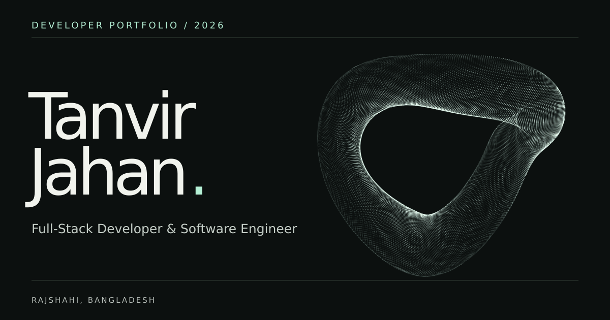

# Tanvir Jahan · Portfolio 2026



A Next.js App Router portfolio for Tanvir Jahan, a full-stack developer and software engineer in Rajshahi, Bangladesh. The primary experience is a server-rendered editorial portfolio with three case studies, professional experience and direct contact links. A separate interactive route presents the work as four particle studies.

## Run locally

Use Node.js 22.13 or newer and npm.

```sh
npm ci
npm run dev
```

Open [localhost:3000](http://localhost:3000). Visit [/experience](http://localhost:3000/experience) to enter the 3D presentation. The standard portfolio also opens at `/?v=site`.

## Validate and serve a production build

```sh
npm run lint
npm run typecheck
npm run build
npm start
```

## Site design and verification checklist

The Site experience at `/` and `/?v=site` adapts the [reference Site view](https://inacionakiti.com/?v=site) to Tanvir’s work. The Story control opens the separate particle presentation at `/experience`.

| Viewport | Reference anchors |
| --- | --- |
| 1363 × 936 | 64px gutters. Central portrait from approximately x=385–860, bottom-aligned. Hero heading starts near (903, 475) in a 396px column, at about 49px with 1.15 leading. Major headings 87px, statement 143px, closing heading 115px. |
| 820 × 1180 | 32px gutters. Globe at upper left, portrait to its right, copy below. Section links remain in the header. |
| 390 × 844 | 16px gutters. Compact name/menu header, central portrait ending around y=553, followed by the headline and actions. Timeline dates join the role entries. |

- General Sans Light, Regular, Semibold and Bold load through the [official Fontshare service](https://www.fontshare.com/fonts/general-sans). The primary colors are black `#0a0a0a`, warm ivory `#eeece8` and violet `#5b5fe0`.
- The page moves from a dark hero to ivory About and Services, then dark Work, Personal Projects, Experience and motto. Principles, After Hours and the FAQ return to ivory before the dark closing invitation.
- Compare the header, portrait area, typography, numbered rules, project hover, sticky timeline, contact panel, menu and footer at matching viewport sizes and section offsets. Verify forward and reverse scrolling, section jumps, touch previews, menu focus and Escape, code grid, and the motto’s alternate reading and restore action.
- A capability emblem, first-person engineering principles, creative coding experiments and local FAQ supply Tanvir’s own content. The footer email opens a mail client. The dock contains Site, Story and code controls. The globe uses public-domain Natural Earth coastal geometry and marks Rajshahi.

The production build was compared in Chrome at all three sizes. The desktop headline measured x=903, y=475 and 396px wide. The phone hero used a two-line headline and left approximately 14px between the actions and bottom dock. The horizontal overflow check covered widths from 320px through 1363px. Project, timeline and principles sections vary in length with the number of real entries and the length of Tanvir’s copy.

[Desktop screenshot](docs/visual-review/desktop.jpg) · [Tablet screenshot](docs/visual-review/tablet.jpg) · [Mobile screenshot](docs/visual-review/mobile.jpg)

### Interim portrait

Tanvir approved his [public GitHub headshot](https://github.com/TanvirJahan001.png) for interim use. Its original 300 × 300 pixels are preserved in `assets/portraits/github-headshot-original.png`. A separate transparent cutout in `public/site/portrait.svg` retains the source proportions and its tight head-and-shoulders crop. The visible silhouette is shorter and less detailed than the reference’s waist-up portrait.

The hero, expanded menu, closing portrait, FAQ avatar and particle sampler all read `profile.portrait` in `lib/content.ts`. When the higher-resolution waist-up photograph arrives, preserve its original, export a separate monochrome transparent cutout and update this field. Recheck the cutout framing on all three viewports, small portrait crops, sampled alpha edges, scroll reversal and the static reduced-motion rendering. Final portrait matching is pending.

## Content and project previews

Edit project records, contact information, experience, skills and chapter descriptions in `lib/content.ts`. The shared orbital geometry is in `lib/orbit.ts`.

| Project | Public sources and preview provenance |
| --- | --- |
| AgencyDesk | [Repository](https://github.com/TanvirJahan001/AgencyDesk) and [read-only demo](https://agency-desk-six.vercel.app/demo). The preview shows the sample dashboard. |
| Mobile Accessories Store | [Repository](https://github.com/TanvirJahan001/AI-Ecommerce) and [product screenshot](https://github.com/TanvirJahan001/AI-Ecommerce/blob/HEAD/artifacts/desktop-charger.png). The case study describes the local development application and its simulated checkout. |
| 3D Developer Desk | [Repository](https://github.com/TanvirJahan001/threejs-room-animation) and [interactive scene](https://threejs-room-animation.vercel.app/). The preview is a camera view captured from the running scene. |

Professional details follow the owner’s [previous portfolio](https://github.com/TanvirJahan001/My-React-Portfolio) and [public profile](https://github.com/TanvirJahan001). The email link opens the visitor’s mail client.

## Deployment

Import this GitHub repository into Vercel, select the Next.js preset and the repository root, and use the standard install and build commands. For a custom domain, set `SITE_URL` to its full HTTPS origin before building. On Vercel the app can also use `VERCEL_PROJECT_PRODUCTION_URL`. The site uses the configured origin for canonical links, social metadata and the sitemap. Without a configured origin, the sitemap uses the incoming request origin and canonical links are omitted.

Metadata endpoints include `/robots.txt`, `/sitemap.xml` and `/social-cover.png`.
